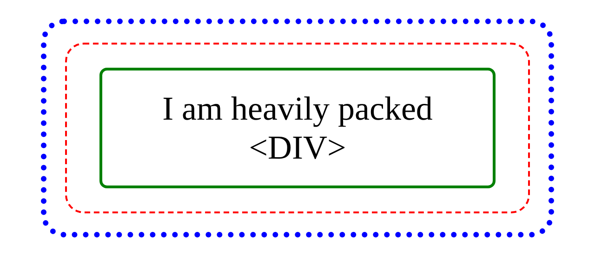

# Bài 2.1.5 – Các kiểu định dạng khung viền

Bài tập CSS trong sách *Bài tập Thiết kế Web*, mục **2.1.5. Các kiểu định dạng khung viền** (Hình 2.6).

## Kết quả



## Yêu cầu

Tạo trang `rectangles.html` gồm 3 thẻ `<div>` lồng nhau:

| Thẻ | Định dạng |
|---|---|
| Outside div | viền chấm (`dotted`) màu xanh dương + `border-radius` + `padding` |
| Middle div | viền gạch (`dashed`) màu đỏ + `border-radius` + `padding` |
| Inner div | viền liền (`solid`) màu xanh lá + `border-radius` + `padding` + `text-align` + `font-size` |

Dùng `&lt;` và `&gt;` để hiển thị ký tự `<` và `>` trong dòng chữ *I am heavily packed &lt;DIV&gt;*.

## Cấu trúc

```
css-khung-vien/
├── rectangles.html   # 3 thẻ div lồng nhau
├── style.css         # định dạng đường viền
└── screenshot.png    # ảnh kết quả
```

## Kiến thức CSS sử dụng

- Thuộc tính viết gọn `border: <độ dày> <kiểu> <màu>` với 3 kiểu viền `dotted`, `dashed`, `solid`
- `border-radius`: bo tròn góc
- `padding`: khoảng cách từ viền vào nội dung, tạo khoảng trống giữa các lớp div
- `text-align: center` và `font-size`: căn giữa, phóng to chữ
- `max-width` + `margin: auto`: giới hạn bề rộng và căn khung ra giữa trang
- Ký tự thực thể HTML: `&lt;` → `<`, `&gt;` → `>`

## Cách chạy

Tải repo về (**Code → Download ZIP**) rồi mở file `rectangles.html` bằng trình duyệt.
